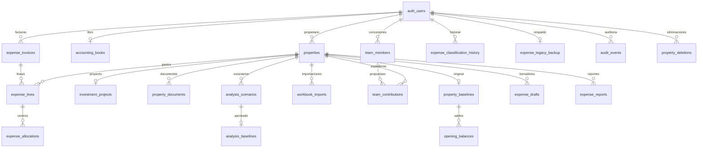

# HU-55 · Modelo PostgreSQL y migración inicial

Fecha: 10 de octubre de 2026. **En verificación**: implementación técnica y ensayo local terminados; pendiente contrastar el modelo con la exportación íntegra de producción de HU-53 y cerrar las dependencias de HU-54. No autoriza el corte ni una importación productiva.

## Entrega y límites

20 tablas en `public`, con los mismos nombres de las tablas del código actual; 120 correspondencias de columnas (112 columnas originales, 1 propietario derivado y 7 proyecciones monetarias). La versión publicada tiene 14 tablas y dos retiradas: `settings` y `attom_receipts` no se crean ni se importan. El diccionario de columnas y las claves están en los archivos [hu55-column-mapping.json](migration/hu55-column-mapping.json) y [hu55-constraints.json](migration/hu55-constraints.json).

Migración: `supabase/migrations/20261010194320_hu55_business_schema.sql`, generada desde el esquema local mediante `supabase db pull --local`. El mensaje de la CLI dice “remote history” incluso con `--local`; en esta ejecución se actualizó exclusivamente el historial del contenedor local. No se vinculó el proyecto remoto.

## Decisiones del modelo

- Los IDs de negocio conservan `text`. `user_id`, `owner_id` y `member_id` usan UUID con referencia restrictiva a `auth.users`. HU-57 debe probar la correspondencia de identidades antes de importar. No asignar por coincidencia de correo ni migrar tokens de invitación anteriores: se reemiten.
- Las FK compuestas incluyen propietario y propiedad/factura/línea para impedir referencias entre carteras. No se aplican borrados en cascada; HU-60/64 implementarán la transacción de eliminación autorizada y la retención.
- `opening_balances.user_id` se deriva de su respaldo padre y se comprueba con FK compuesta. Las facturas no tienen una propiedad única: cada línea señala su propiedad y las distribuciones por centro dependen de la línea.
- `analysis_baselines` solo admite escenarios de la misma propiedad y propietario. `source_id` conserva procedencia histórica como texto nullable sin FK: no exige mantener vivo el escenario original.
- `audit_events.property_id` y `property_deletions.id` son referencias históricas sin FK a propiedades; deben sobrevivir a su eliminación. La inmutabilidad de auditoría y prohibición de recrear IDs borrados se implementan en HU-60/64. Aquí ninguna API tiene permiso de escritura.
- `created_at`, `updated_at`, `captured_at` y `deleted_at` son `timestamptz`. El importador deberá exigir zona explícita y rechazar fechas ambiguas; PostgreSQL por sí solo acepta fechas sin zona. Las fechas civiles dentro del JSON, como vencimiento, siguen `YYYY-MM-DD`. `original_updated_at` y `version` permanecen texto exacto. HU-60 debe adaptar la comparación de versiones de `updated_at` por instante: la representación textual de PostgreSQL no es idéntica al ISO original.
- El JSON operativo usa `jsonb` objeto; `object_keys` usa array. Los respaldos `original_payload` y `expense_legacy_backup.payload` conservan texto exacto. El respaldo íntegro de origen sigue siendo necesario: jsonb no conserva espacios, orden ni claves duplicadas; detectar estas últimas antes de convertir en HU-59.
- USD es la moneda de este modelo. Saldos iniciales usan `numeric`; subtotal, impuesto, retención, incluido y total declarado se proyectan como columnas `numeric` generadas del JSON canónico. Se rechazan valores negativos, superiores a 1.000 millones, ausentes o con más de dos decimales; nunca se redondea silenciosamente en la base. Los precios/cantidades del detalle conservan hasta cuatro decimales en JSON. El cálculo existente redondea el producto a centavos; la migración no recalcula importes históricos. Créditos se representan por el tipo/referencia de factura y montos positivos.
- Los pagos, proveedores, presupuesto y otros módulos anidados permanecen en el JSON del libro/propiedad. No hay copia paralela editable de sus importes. La extracción administrativa y conciliación corresponden a HU-59/63; no se afirma que todos los importes anidados tengan ya restricciones SQL individuales.
- Índices por propietario, propiedad, factura, línea, concesión y fecha. Se preserva unicidad de solicitud de factura por propietario, hash de importación, objeto de archivo y versión documental por propietario/grupo. Optimización con carga real pendiente de HU-65.
- RLS activado en las 20 tablas; sin políticas ni permisos API para `anon`, `authenticated` o `service_role`. Las lecturas/escrituras quedan cerradas hasta HU-58. No se concede acceso al libro completo a colaboradores. El administrador local puede inspeccionar tablas desde Studio.

## Relaciones principales

Todas las relaciones de negocio relevantes incluyen el propietario, aunque el diagrama las simplifique. Auth pertenece al servicio Supabase y no se recrea en la migración de aplicación.

## Evidencia y reproducción

`python3 scripts/migration/test_hu55_local.py` ejecutó **15 verificaciones contra Supabase local y las mismas 15 tras recrear el esquema en una base vacía desechable**. La base desechable usa un destino mínimo `auth.users(id)` solo para resolver las FK; el primer ensayo usa Auth real local. Verifica RLS/permisos, fechas equivalentes, factura distribuida entre propiedades, suma decimal exacta, rechazo de cruces entre propietarios, huérfanos, duplicados, exceso de decimales, negativos y montos ausentes, JSON inválido por forma, bloqueo de borrado financiero, escenario ajeno y conservación del respaldo/auditoría.

Los datos sintéticos se revierten con ROLLBACK y la base desechable se elimina. Las tablas locales quedan vacías. La migración figura aplicada en el historial local. Advisors: sin errores ni advertencias; avisos informativos por índices todavía sin tráfico y RLS sin políticas, esperados mientras HU-58 está pendiente. No se valida todavía la matriz de colaboradores, sesiones de la app, importación real ni cálculos de extremo a extremo.

Studio: http://127.0.0.1:54323/project/default. Abrir Table Editor y esquema `public` para consultar la estructura. El sitio publicado todavía utiliza D1/R2 y su autenticación actual.

## Diccionario por columna

Origen y destino comparten nombre de tabla salvo el prefijo `public`. PK, FK, CHECK y UNIQUE completos están en el archivo de restricciones enlazado arriba.

### properties

| Origen | Destino | Tipo | Nulo | Transformación |
|---|---|---|---|---|
| id | id | text | No | Conservar valor |
| user_id | user_id | uuid | No | Vínculo verificado HU-57; nunca convertir el ID anterior directamente a UUID |
| payload | payload | jsonb | No | Parsear JSON válido; conservar original en respaldo íntegro HU-53/59 |
| updated_at | updated_at | timestamptz | No | Exigir ISO-8601 con Z/offset; rechazar fecha sin zona; normalizar a UTC |

### property_baselines

| Origen | Destino | Tipo | Nulo | Transformación |
|---|---|---|---|---|
| property_id | property_id | text | No | Conservar valor |
| user_id | user_id | uuid | No | Vínculo verificado HU-57; nunca convertir el ID anterior directamente a UUID |
| original_payload | original_payload | text | No | Conservar texto exacto sin reserializar |
| original_updated_at | original_updated_at | text | No | Conservar texto exacto sin reserializar |
| captured_at | captured_at | timestamptz | No | Exigir ISO-8601 con Z/offset; rechazar fecha sin zona; normalizar a UTC |

### investment_projects

| Origen | Destino | Tipo | Nulo | Transformación |
|---|---|---|---|---|
| property_id | property_id | text | No | Conservar valor |
| user_id | user_id | uuid | No | Vínculo verificado HU-57; nunca convertir el ID anterior directamente a UUID |
| schema_version | schema_version | integer | No | Conservar valor |
| origin | origin | text | No | Conservar valor |
| created_at | created_at | timestamptz | No | Exigir ISO-8601 con Z/offset; rechazar fecha sin zona; normalizar a UTC |

### opening_balances

| Origen | Destino | Tipo | Nulo | Transformación |
|---|---|---|---|---|
| (derivado) | user_id | uuid | No | Derivar del propietario verificado de property_baselines |
| property_id | property_id | text | No | Conservar valor |
| line_id | line_id | text | No | Conservar valor |
| amount | amount | numeric | No | Decimal USD exacto, máximo 2 decimales; rechazar exceso sin redondear |
| source | source | text | No | Conservar valor |

### property_documents

| Origen | Destino | Tipo | Nulo | Transformación |
|---|---|---|---|---|
| id | id | text | No | Conservar valor |
| group_id | group_id | text | No | Conservar valor |
| property_id | property_id | text | No | Conservar valor |
| user_id | user_id | uuid | No | Vínculo verificado HU-57; nunca convertir el ID anterior directamente a UUID |
| version | version | integer | No | Conservar valor |
| object_key | object_key | text | No | Conservar valor |
| filename | filename | text | No | Conservar valor |
| mime | mime | text | No | Conservar valor |
| size | size | bigint | No | Conservar valor |
| sha256 | sha256 | text | No | Conservar valor |
| title | title | text | No | Conservar valor |
| category | category | text | No | Conservar valor |
| link_type | link_type | text | No | Conservar valor |
| link_ref | link_ref | text | No | Conservar valor |
| note | note | text | No | Conservar valor |
| created_at | created_at | timestamptz | No | Exigir ISO-8601 con Z/offset; rechazar fecha sin zona; normalizar a UTC |

### analysis_scenarios

| Origen | Destino | Tipo | Nulo | Transformación |
|---|---|---|---|---|
| id | id | text | No | Conservar valor |
| property_id | property_id | text | No | Conservar valor |
| user_id | user_id | uuid | No | Vínculo verificado HU-57; nunca convertir el ID anterior directamente a UUID |
| label | label | text | No | Conservar valor |
| source_id | source_id | text | Sí | Conservar valor |
| payload | payload | jsonb | No | Parsear JSON válido; conservar original en respaldo íntegro HU-53/59 |
| created_at | created_at | timestamptz | No | Exigir ISO-8601 con Z/offset; rechazar fecha sin zona; normalizar a UTC |

### analysis_baselines

| Origen | Destino | Tipo | Nulo | Transformación |
|---|---|---|---|---|
| property_id | property_id | text | No | Conservar valor |
| user_id | user_id | uuid | No | Vínculo verificado HU-57; nunca convertir el ID anterior directamente a UUID |
| scenario_id | scenario_id | text | No | Conservar valor |
| created_at | created_at | timestamptz | No | Exigir ISO-8601 con Z/offset; rechazar fecha sin zona; normalizar a UTC |

### accounting_books

| Origen | Destino | Tipo | Nulo | Transformación |
|---|---|---|---|---|
| user_id | user_id | uuid | No | Vínculo verificado HU-57; nunca convertir el ID anterior directamente a UUID |
| payload | payload | jsonb | No | Parsear JSON válido; conservar original en respaldo íntegro HU-53/59 |
| updated_at | updated_at | timestamptz | No | Exigir ISO-8601 con Z/offset; rechazar fecha sin zona; normalizar a UTC |

### audit_events

| Origen | Destino | Tipo | Nulo | Transformación |
|---|---|---|---|---|
| id | id | text | No | Conservar valor |
| user_id | user_id | uuid | No | Vínculo verificado HU-57; nunca convertir el ID anterior directamente a UUID |
| property_id | property_id | text | No | Conservar valor |
| module | module | text | No | Conservar valor |
| payload | payload | jsonb | No | Parsear JSON válido; conservar original en respaldo íntegro HU-53/59 |
| created_at | created_at | timestamptz | No | Exigir ISO-8601 con Z/offset; rechazar fecha sin zona; normalizar a UTC |

### workbook_imports

| Origen | Destino | Tipo | Nulo | Transformación |
|---|---|---|---|---|
| id | id | text | No | Conservar valor |
| user_id | user_id | uuid | No | Vínculo verificado HU-57; nunca convertir el ID anterior directamente a UUID |
| property_id | property_id | text | No | Conservar valor |
| hash | hash | text | No | Conservar valor |
| payload | payload | jsonb | No | Parsear JSON válido; conservar original en respaldo íntegro HU-53/59 |
| created_at | created_at | timestamptz | No | Exigir ISO-8601 con Z/offset; rechazar fecha sin zona; normalizar a UTC |

### team_members

| Origen | Destino | Tipo | Nulo | Transformación |
|---|---|---|---|---|
| id | id | text | No | Conservar valor |
| owner_id | owner_id | uuid | No | Vínculo verificado HU-57; nunca convertir el ID anterior directamente a UUID |
| member_id | member_id | uuid | Sí | Vínculo verificado HU-57; nunca convertir el ID anterior directamente a UUID |
| token_hash | token_hash | text | No | Conservar valor |
| payload | payload | jsonb | No | Parsear JSON válido; conservar original en respaldo íntegro HU-53/59 |
| updated_at | updated_at | timestamptz | No | Exigir ISO-8601 con Z/offset; rechazar fecha sin zona; normalizar a UTC |

### team_contributions

| Origen | Destino | Tipo | Nulo | Transformación |
|---|---|---|---|---|
| id | id | text | No | Conservar valor |
| grant_id | grant_id | text | No | Conservar valor |
| owner_id | owner_id | uuid | No | Vínculo verificado HU-57; nunca convertir el ID anterior directamente a UUID |
| property_id | property_id | text | No | Conservar valor |
| payload | payload | jsonb | No | Parsear JSON válido; conservar original en respaldo íntegro HU-53/59 |
| created_at | created_at | timestamptz | No | Exigir ISO-8601 con Z/offset; rechazar fecha sin zona; normalizar a UTC |

### expense_invoices

| Origen | Destino | Tipo | Nulo | Transformación |
|---|---|---|---|---|
| user_id | user_id | uuid | No | Vínculo verificado HU-57; nunca convertir el ID anterior directamente a UUID |
| id | id | text | No | Conservar valor |
| position | position | integer | No | Conservar valor |
| request_id | request_id | text | Sí | Conservar valor |
| payload | payload | jsonb | No | Parsear JSON válido; conservar original en respaldo íntegro HU-53/59 |
| payload.declaredTotal | declared_total | numeric (generated) | No | Proyección calculada del JSON canónico; USD exacto, máximo 2 decimales |

### expense_lines

| Origen | Destino | Tipo | Nulo | Transformación |
|---|---|---|---|---|
| user_id | user_id | uuid | No | Vínculo verificado HU-57; nunca convertir el ID anterior directamente a UUID |
| id | id | text | No | Conservar valor |
| invoice_id | invoice_id | text | No | Conservar valor |
| property_id | property_id | text | No | Conservar valor |
| position | position | integer | No | Conservar valor |
| payload | payload | jsonb | No | Parsear JSON válido; conservar original en respaldo íntegro HU-53/59 |
| payload.subtotal | subtotal | numeric (generated) | No | Proyección calculada del JSON canónico; USD exacto, máximo 2 decimales |
| payload.tax | tax | numeric (generated) | No | Proyección calculada del JSON canónico; USD exacto, máximo 2 decimales |
| payload.retention | retention | numeric (generated) | No | Proyección calculada del JSON canónico; USD exacto, máximo 2 decimales |
| payload.included | included | numeric (generated) | No | Proyección calculada del JSON canónico; USD exacto, máximo 2 decimales |

### expense_allocations

| Origen | Destino | Tipo | Nulo | Transformación |
|---|---|---|---|---|
| user_id | user_id | uuid | No | Vínculo verificado HU-57; nunca convertir el ID anterior directamente a UUID |
| line_id | line_id | text | No | Conservar valor |
| position | position | integer | No | Conservar valor |
| payload | payload | jsonb | No | Parsear JSON válido; conservar original en respaldo íntegro HU-53/59 |
| payload.subtotal | subtotal | numeric (generated) | No | Proyección calculada del JSON canónico; USD exacto, máximo 2 decimales |
| payload.tax | tax | numeric (generated) | No | Proyección calculada del JSON canónico; USD exacto, máximo 2 decimales |

### expense_classification_history

| Origen | Destino | Tipo | Nulo | Transformación |
|---|---|---|---|---|
| user_id | user_id | uuid | No | Vínculo verificado HU-57; nunca convertir el ID anterior directamente a UUID |
| id | id | text | No | Conservar valor |
| position | position | integer | No | Conservar valor |
| payload | payload | jsonb | No | Parsear JSON válido; conservar original en respaldo íntegro HU-53/59 |

### expense_legacy_backup

| Origen | Destino | Tipo | Nulo | Transformación |
|---|---|---|---|---|
| user_id | user_id | uuid | No | Vínculo verificado HU-57; nunca convertir el ID anterior directamente a UUID |
| payload | payload | text | No | Conservar texto exacto sin reserializar |
| version | version | text | No | Conservar valor |
| created_at | created_at | timestamptz | No | Exigir ISO-8601 con Z/offset; rechazar fecha sin zona; normalizar a UTC |

### expense_drafts

| Origen | Destino | Tipo | Nulo | Transformación |
|---|---|---|---|---|
| user_id | user_id | uuid | No | Vínculo verificado HU-57; nunca convertir el ID anterior directamente a UUID |
| id | id | text | No | Conservar valor |
| property_id | property_id | text | No | Conservar valor |
| status | status | text | No | Conservar valor |
| payload | payload | jsonb | No | Parsear JSON válido; conservar original en respaldo íntegro HU-53/59 |
| updated_at | updated_at | timestamptz | No | Exigir ISO-8601 con Z/offset; rechazar fecha sin zona; normalizar a UTC |

### expense_reports

| Origen | Destino | Tipo | Nulo | Transformación |
|---|---|---|---|---|
| user_id | user_id | uuid | No | Vínculo verificado HU-57; nunca convertir el ID anterior directamente a UUID |
| id | id | text | No | Conservar valor |
| property_id | property_id | text | No | Conservar valor |
| payload | payload | jsonb | No | Parsear JSON válido; conservar original en respaldo íntegro HU-53/59 |
| created_at | created_at | timestamptz | No | Exigir ISO-8601 con Z/offset; rechazar fecha sin zona; normalizar a UTC |

### property_deletions

| Origen | Destino | Tipo | Nulo | Transformación |
|---|---|---|---|---|
| id | id | text | No | Conservar valor |
| user_id | user_id | uuid | No | Vínculo verificado HU-57; nunca convertir el ID anterior directamente a UUID |
| name | name | text | No | Conservar valor |
| version | version | text | No | Conservar valor |
| deleted_at | deleted_at | timestamptz | No | Exigir ISO-8601 con Z/offset; rechazar fecha sin zona; normalizar a UTC |
| object_keys | object_keys | jsonb | No | Parsear JSON válido; conservar original en respaldo íntegro HU-53/59 |

## Referencias técnicas

- [RLS de Supabase](https://supabase.com/docs/guides/database/postgres/row-level-security).
- [Tipos numéricos PostgreSQL](https://www.postgresql.org/docs/17/datatype-numeric.html).
